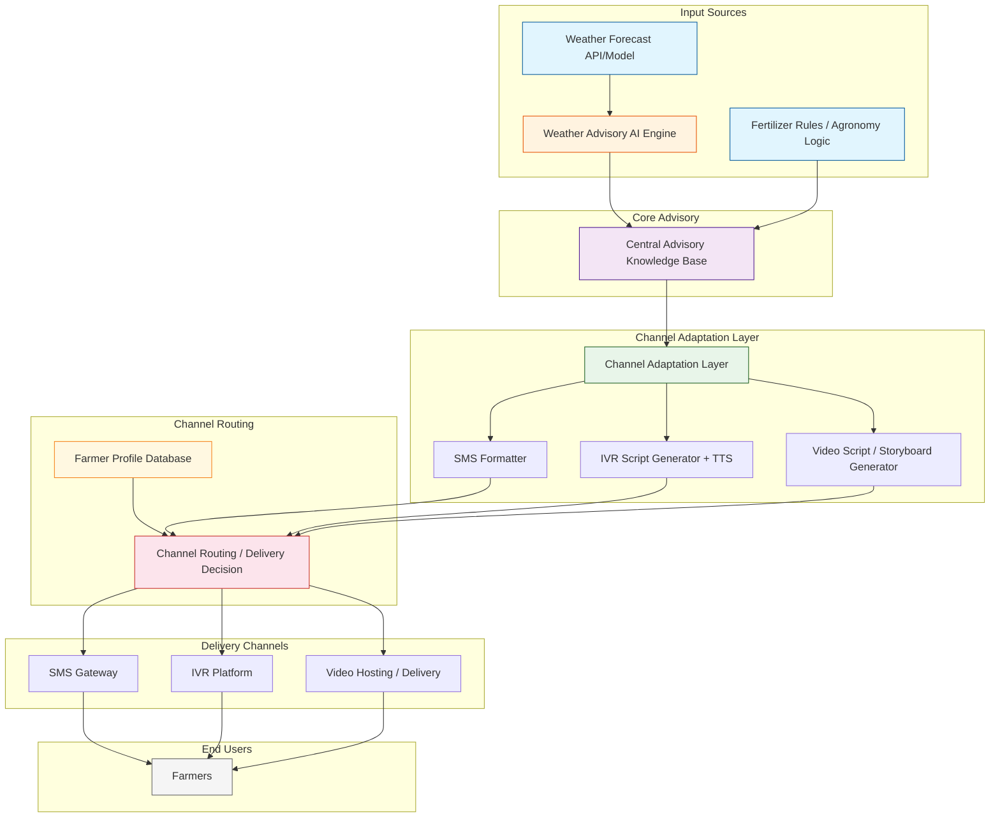

# Question 2 - Centralized Advisory for Ethiopia: Architecture

Exported diagram artifact for submission:

- `Advisory Architecture.drawio.png`

## Mermaid Diagram Source

## Explanation

My main assumption is that both weather and fertilizer advisories can be stored in a single structured knowledge base before being converted into channel-specific formats. In this design, the AI component is used only for the weather advisory, where forecast data is translated into farmer-friendly recommendations, while fertilizer advice is generated from more stable agronomic rules. The channel adaptation layer prevents the content team from rewriting the same message separately for SMS, IVR, and video. Farmer profile data then determines whether a farmer receives text, voice, video, or a combination based on device access, literacy, and connectivity. One realistic external dependency is a weather forecast API or model, since the weather advisory depends on timely forecast inputs. A key risk in this design is that inaccurate forecasts or weak connectivity could reduce the usefulness of the final advisory for some farmers. Before finalizing the system, I would ask the technical team how farmer profiles are updated over time so channel decisions stay accurate when device access or network conditions change.
